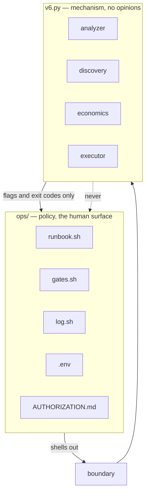

# Architecture

## The one rule

**Policy lives in `ops/`. Mechanism lives in `v6.py`.** The engine is a leaf.



## Four hard rules

1. **Import direction is one-way.** `ops/` may call the engine. The engine may
   never import from `ops/`.
2. **The engine never reads `.env`.** No `os.environ` lookups for policy. The
   launcher loads `.env` and passes `--pk` and `--api-key` explicitly.
3. **The engine never prompts.** No `input()`. The launcher owns the dialogue.
4. **The engine never writes logs.** It prints to stdout and returns an exit
   code. The launcher tees to `logs/`.

`tests/test_boundary.py` fails the build if any of these is broken.

## The hard rule that matters most

`--execute` without `--target` is an **error**.

Live mode never discovers. Discovery picks contracts that strangers deployed,
hours ago, that you have never read. Firing at those is the riskiest thing the
tool can do. So live mode only ever fires at a contract you typed by hand.

## Engine contract

| Flag | Meaning |
|---|---|
| `--self-test` | offline correctness, no network |
| `--plan` | discovery + ranking, never executes |
| `--target ADDR --chain C` | analyse one contract, no discovery |
| `--execute` | with `--target`, actually send |
| `--max N` | cap steps |
| `--pk` / `--api-key` | explicit, never from env |
| `--rpc chain=url` | override endpoint |

| Exit | Meaning |
|---|---|
| 0 | executed, all steps ok |
| 1 | executed, a step failed |
| 2 | usage or config error |
| 3 | analysed, nothing above threshold |

## Data flow, target mode

```
--target
  -> fetch code + source (no discovery)
  -> analyse_source   (function-scoped rules, pragma gated)
  -> analyse_bytecode (real disassembler)
  -> probe            (EIP-1967 slots, differential owner probe)
  -> economics        (sequential claim model, live gas price)
  -> ranked plan
  -> if --execute: executor
       simulate (estimate_gas + eth_call)
       send (EIP-1559 or legacy, pending nonce)
       verify (native + token deltas)
```
